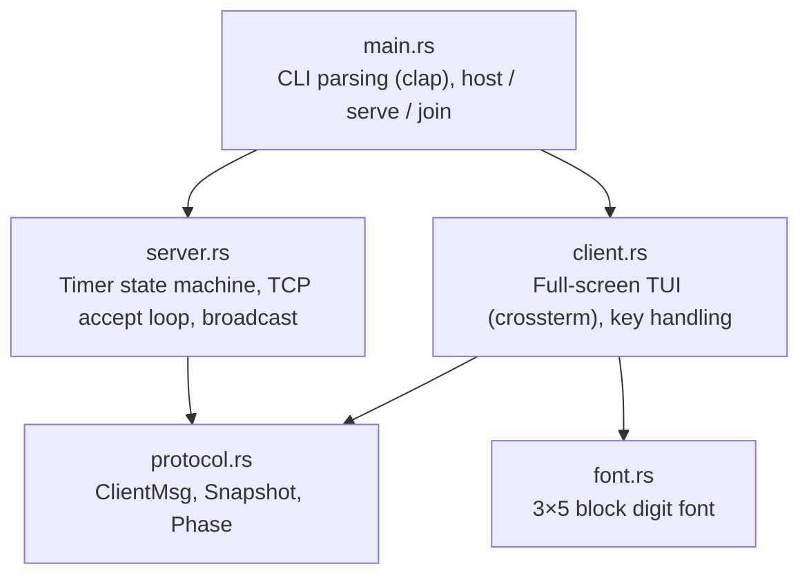
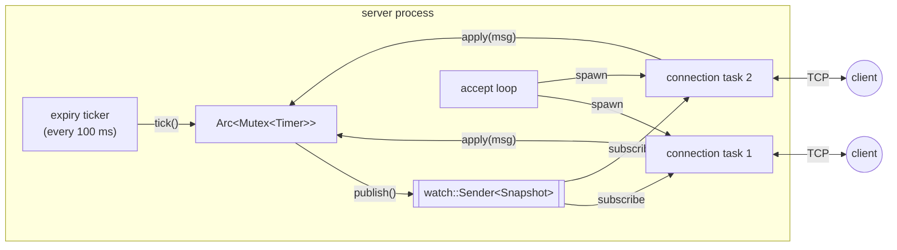
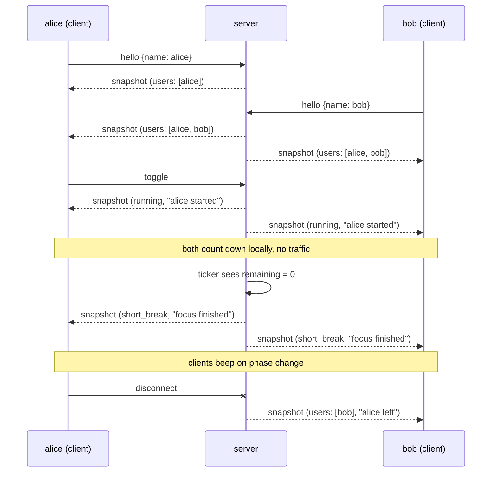
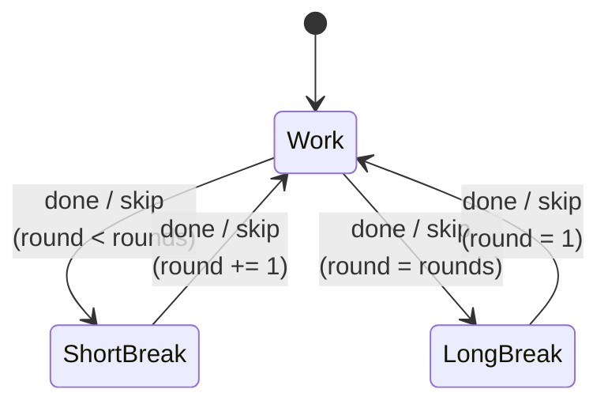
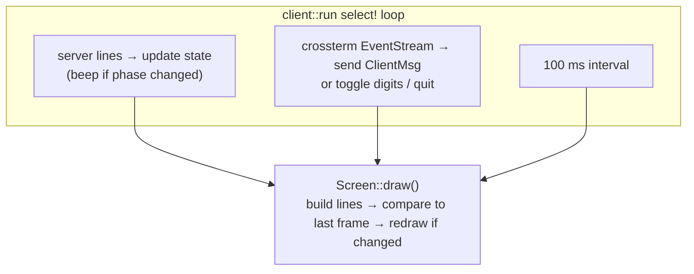

# Architecture

pomodors is a single binary with a server that owns one timer, and clients that
display it. They talk over plain TCP using newline-delimited JSON. There is no HTTP.

## Modules

`host` runs both halves in one process: it spawns `server::run` as a tokio task
and then runs `client::run` against it over loopback. It uses the same code path
as a remote `join`.

## Server

- **`Timer`** holds the phase, round, connected users and the last action. Time is
  stored as `remaining` plus an optional `started_at: Instant`. Pausing folds the
  elapsed time into `remaining`, so the server never has to count down itself.
- **`publish()`** takes a `Snapshot` of the timer and writes it to a
  `tokio::sync::watch` channel. A watch channel only keeps the latest value, so a
  slow client skips stale states instead of building up a backlog.
- **Connection tasks** each `select!` on two things: lines from their socket
  (commands to apply) and changes on the watch channel (snapshots to send).
- **The expiry ticker** checks every 100 ms whether a running phase has reached
  zero, advances it, and publishes.

The mutex is a `std::sync::Mutex` and is never held across an `.await`.

## Protocol

Every message is one JSON object followed by `\n`.

| Direction | Message | Example |
| --- | --- | --- |
| client → server | `hello` | `{"type":"hello","name":"alice"}` |
| client → server | `toggle` | `{"type":"toggle"}` |
| client → server | `reset` | `{"type":"reset"}` |
| client → server | `skip` | `{"type":"skip"}` |
| server → client | snapshot | `{"phase":"work","remaining_ms":1499000,"running":true,"round":1,"rounds":4,"users":["alice","bob"],"last_action":"alice started"}` |

The server only sends a snapshot when something changes. Clients count down
locally between updates using `remaining_ms` and the time they received the snapshot.

## Timer phases

Independently of the phase, the timer is either running or paused:

- **toggle** switches between them.
- **reset** restores the current phase's full duration and pauses.
- **skip** advances the phase and keeps the current running state.
- **Natural expiry** advances the phase and pauses, unless `--auto-start` is set.

## Client

- `TerminalGuard` enables raw mode, enters the alternate screen and hides the
  cursor. It undoes all of this on drop, and a panic hook does the same so a crash
  doesn't leave the terminal broken.
- `Screen::build` turns the state into a list of styled lines. `draw` only writes
  to the terminal when that list (or the terminal size) has changed. That keeps
  output to about one redraw per second and avoids flicker.
- Big digits come from `font::render`, which draws each pixel of a 3×5 bitmap as
  `██`. If the result is wider than the terminal, it falls back to plain text.
