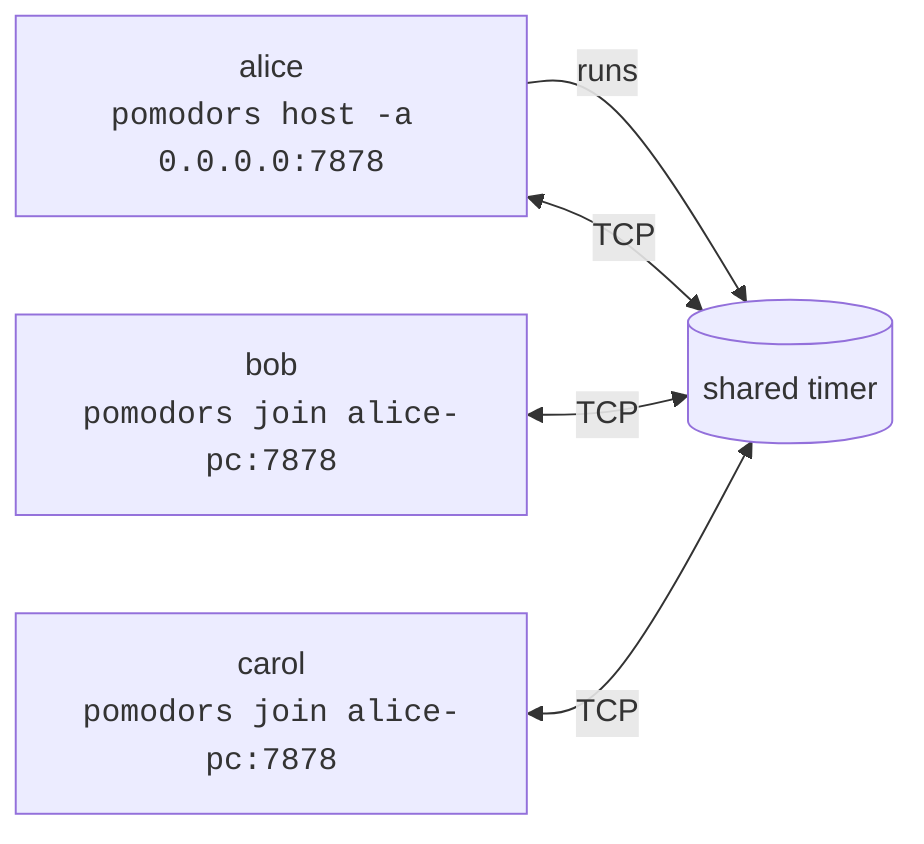

# pomodors

A shared pomodoro timer for the terminal. One person hosts, anyone can join, and
everyone sees the same full-screen countdown. Anyone connected can start, pause,
reset or skip.

```
                         FOCUS

  ██████  ██  ██      ██████  ██████
      ██  ██  ██  ██  ██      ██  ██
  ██████  ██████      ██████  ██████
  ██          ██  ██      ██      ██
  ██████      ██      ██████  ██████

       ▶ running  ·  pomodoro 1/4
             alice started

       2 connected: alice, bob
```

## Install

```sh
cargo install --path .
```

## Usage

```sh
pomodors host                         # start a timer and join it from this terminal
pomodors host -a 0.0.0.0:7878         # same, but reachable from your network
pomodors serve                        # headless timer that others can join
pomodors join 192.168.1.5:7878 --name bob --digits normal
```



When the server is reachable from other machines, `host` shows the exact
`pomodors join …` commands others can use (one per network interface), and
`serve` prints them on startup:

```
$ pomodors serve -a 0.0.0.0:7878
pomodors server listening on 0.0.0.0:7878
  pomodors join 192.168.2.25:7878  (wlp7s0)
  pomodors join 100.86.204.119:7878  (tailscale0)
```

If nobody can connect, check that your firewall allows incoming TCP on the port.

### Commands

| Command | What it does |
| --- | --- |
| `host` | Runs a timer server and opens the full-screen view in this terminal. The server stops when you quit. |
| `serve` | Runs only the timer server, with no screen. Use this if the timer should outlive any one person. |
| `join [ADDR]` | Connects to a running timer. Defaults to `127.0.0.1:7878`. |

### Options

Timer options (`host`, `serve`):

| Option | Default | Description |
| --- | --- | --- |
| `-a, --addr` | `127.0.0.1:7878` | Address to listen on. Use `0.0.0.0:7878` to accept connections from other machines. |
| `-w, --work` | `25m` | Work session length. |
| `--short-break` | `5m` | Short break length. |
| `--long-break` | `15m` | Long break length. |
| `--rounds` | `4` | Work sessions before a long break. |
| `--auto-start` | off | Start the next phase automatically instead of pausing. |

Durations accept `90s`, `25m`, `1h`, or a bare number of minutes.

Display options (`host`, `join`):

| Option | Default | Description |
| --- | --- | --- |
| `-n, --name` | `$USER` | Name shown to other users. |
| `-d, --digits` | `big` | `big` for block digits, `normal` for plain text. Falls back to plain text if the window is too narrow. |

### Keys

| Key | Action |
| --- | --- |
| `space` / `p` | Start or pause |
| `r` | Reset the current phase |
| `s` | Skip to the next phase |
| `b` | Toggle big/normal digits (local only) |
| `q` / `Esc` / `Ctrl-C` | Quit |

The terminal beeps when a phase ends.

## Security

There is no authentication or encryption. Anyone who can reach the address can
join and control the timer. The default bind address is loopback; only bind to
`0.0.0.0` on networks you trust.

## Development

```sh
cargo test
cargo clippy
```

See [ARCHITECTURE.md](ARCHITECTURE.md) for how it works.

## License

Licensed under either of [Apache License, Version 2.0](LICENSE-APACHE) or
[MIT license](LICENSE-MIT), at your option.
